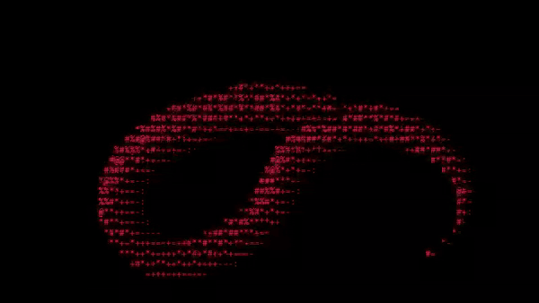
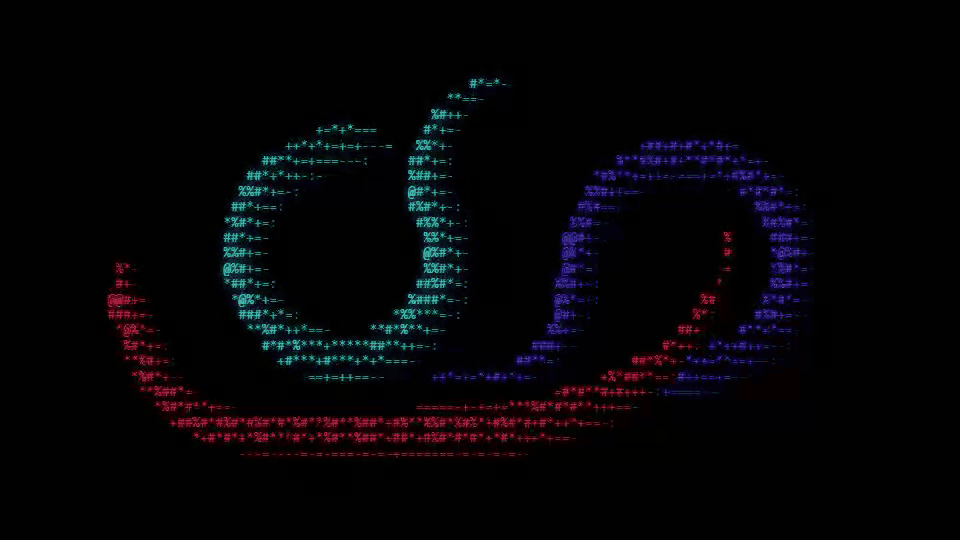

# ascii-worm

A 3D worm made of text characters that crawls over your terminal. It also runs in the browser.



**Live demo:** [one worm](https://david-vrba.github.io/ascii-worm/) · [three worms](https://david-vrba.github.io/ascii-worm/?worms=3) · [purple](https://david-vrba.github.io/ascii-worm/?color=purple)

## Install

You need Node.js 16 or newer. There are no dependencies.

```bash
npm install -g github:david-vrba/ascii-worm
worm
```

Or run it from a clone:

```bash
git clone https://github.com/david-vrba/ascii-worm
cd ascii-worm
node worm.js
```

## Use

| Command | Result |
|---|---|
| `worm` | one red worm |
| `worm -c purple` | one purple worm |
| `worm -2` | two worms: red and purple |
| `worm -3` | three worms: red, purple and cyan |
| `worm -3 -c green` | three green worms |
| `worm -3 -c red,yellow,blue` | three worms, one colour each |
| `worm -2 -c pink,ff8800` | a pink worm and an orange (hex) worm |
| `worm -h` | help with every option |

Press `q`, `Esc` or `Ctrl+C` to quit. You can resize the window at any time. The worms follow the new size.

### Colours

`red` `orange` `yellow` `green` `cyan` `blue` `purple` `pink` `white`, or any hex code such as `ff8800`. In PowerShell, put a code that starts with `#` in quotes: `worm -c "#ff8800"`.

One colour paints every worm. A list gives one colour per worm, and a short list repeats. The limit is 3 worms.



## Web version

Open `index.html` in a browser, or use the live demo. The terminal options work as URL parameters:

- `?worms=3`
- `?color=purple`
- `?worms=2&color=pink,cyan`

## How it works

1. The head steers toward a slow Lissajous point that sweeps the screen. If the path ahead leaves the screen, the head makes a tighter turn back toward the centre.
2. The body follows the exact path the head took. Loops and curls stay in place while the worm crawls through them.
3. Each pair of spine points is a capsule. Every character cell inside it gets a 3D surface normal from its offset to the spine.
4. Light from the upper left sets the brightness of each cell. The brightness picks a character from `:-=+*#%@`. `@` faces the light and `:` is the shadow side.
5. A depth buffer decides which part is in front where the body crosses itself.
6. All sizes are fractions of the shorter screen side, so the worm scales with the window.

One engine, `worm-core.js`, drives the terminal and the browser.

## Over SSH

The terminal version uses 24-bit colour in Windows Terminal, iTerm2, WezTerm, Ghostty and VS Code. In other terminals, and over SSH where that hint is often lost, it uses the 256-colour palette. If the connection is slow, it drops frames instead of queueing them.

## For AI agents

- [AGENTS.md](AGENTS.md) has the file map, the rules and the check command.
- If stdout is not a terminal, `worm` prints one plain-text frame of 100×30 characters and exits. Run `node worm.js -3 > frame.txt` to see the worms without a terminal.
- `node check.js` tests steering, screen coverage, resize recovery and colour parsing.

## About

A side project by [David Vrba](https://github.com/david-vrba). Inspired by a red ASCII worm in a short video clip. The code is written from scratch.

[MIT licence](LICENSE).
